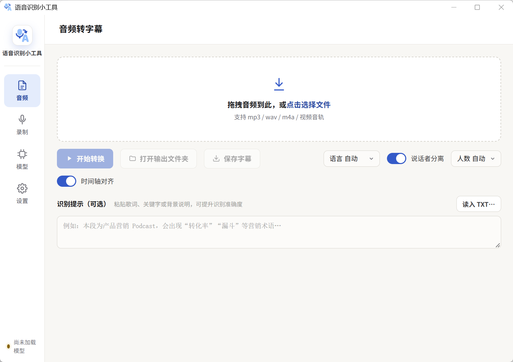
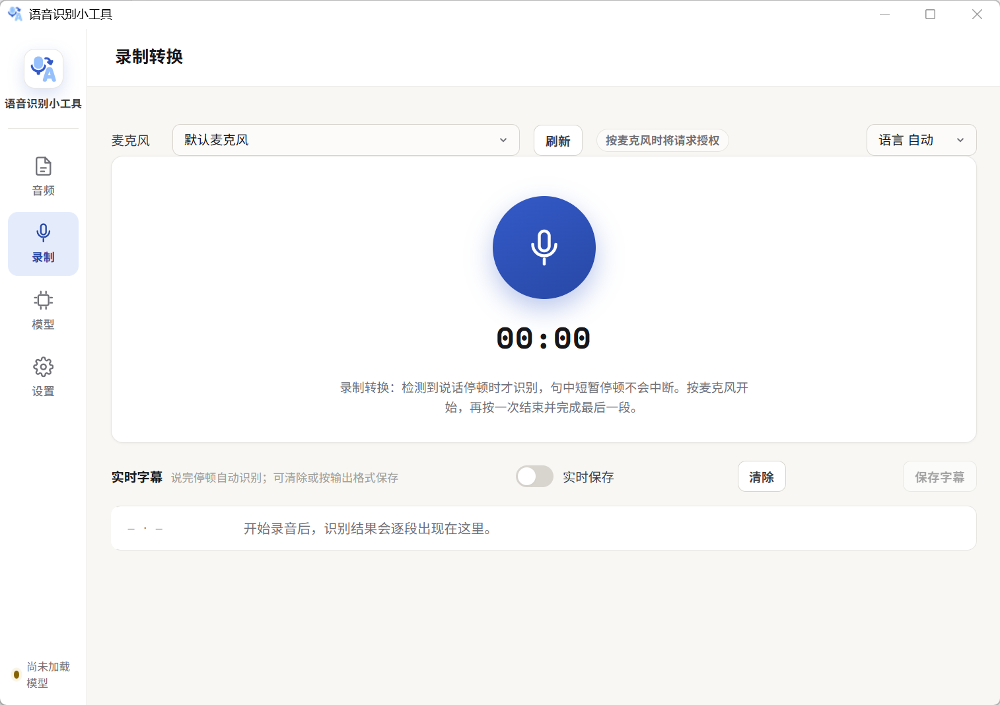
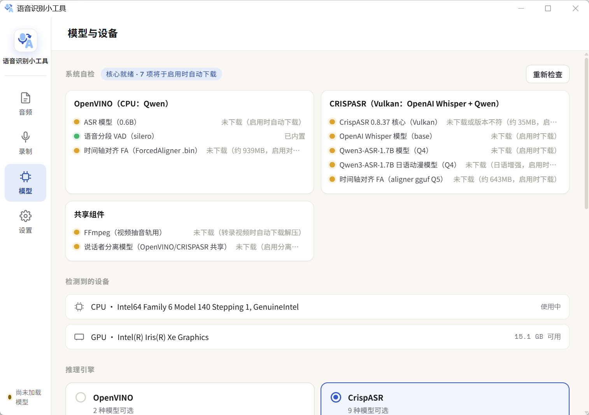
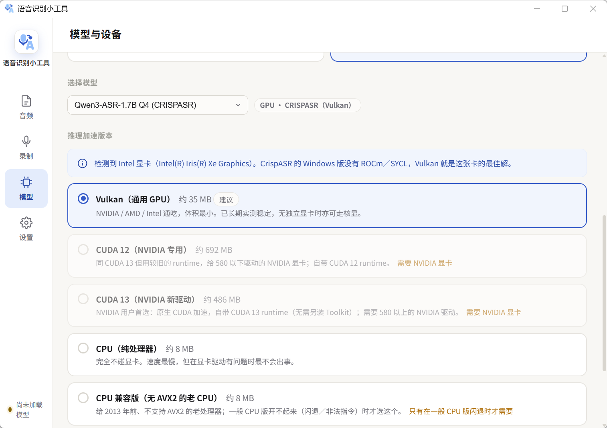
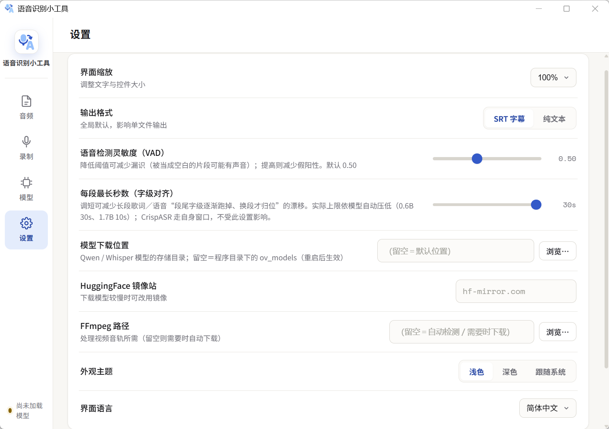

# STTMiniTool（语音识别小工具）

本地语音识别字幕生成工具 —— **数据不离开你的电脑**。以 Qwen3-ASR / OpenAI Whisper 为核心，
音频、视频、麦克风录音都能转成 SRT 字幕。**WebView 界面**（原生 WebView2 窗口），
支持纯 CPU（OpenVINO INT8）与 GPU 加速（CrispASR：CUDA / Vulkan，NVIDIA / AMD / Intel）。

> **上游项目**：本仓库是 [dseditor/QwenASRMiniTool](https://github.com/dseditor/QwenASRMiniTool)
> 的本地改进分支（fork 起点 v2.0.0）。上游的繁体中文界面、批量识别、端点服务等内容在本分支中
> 已按需移除或替换。本仓库地址：https://github.com/Superce1l/STTMiniTool
>
> 当前版本 **v2.2.6** · [下载最新版](https://github.com/Superce1l/STTMiniTool/releases/latest) · [版本历史](#版本历史)

---

## 界面预览

**音频转字幕** —— 拖入音频（或视频），设置语言、说话者分离、时间轴对齐即可开始：

<p align="center">
  
</p>

**录制转换** 与 **模型与设备**：

<p align="center">
  
  
</p>

**推理加速版本选择** 与 **设置**：

<p align="center">
  
  
</p>

---

## 主要特色

- 🎧 **音频 / 视频 → SRT 字幕**：MP3・WAV・FLAC・M4A・OGG 等音频，及 MP4・MKV・MOV 等视频（自动用 ffmpeg 抽音轨）
- 🎙️ **麦克风录制转换**：检测说话停顿自动分段识别（非逐字流式），可实时存档
- 🌊 **真实波形 + 播放头 + 分段标注**：点波形／字幕／区块即可跳播
- 🎤 **卡拉OK逐字模式**：字级时间轴贯通，播放时逐字高亮歌词
- 🌏 **多语言识别**：中文、日文、英文等常用语言，可自动检测或锁定语言
- 🇯🇵 **日语强化**：内置 **Qwen3-ASR-1.7B 日语动漫**特化模型；日语输出保留原生汉字
- 👥 **说话者分离**：可指定人数，SRT 自动标记「说话者1／2…」
- 💬 **识别提示（参考文字）**：贴入歌词、关键字或背景说明，提升识别准确度
- 🧩 **多推理核心 + 热切换**：CrispASR（GPU：CUDA／Vulkan 可选）／OpenVINO（纯 CPU），模型页切换免重启、就地热切换
- 📜 **运行日志**：转录／加载／下载事件自动记录到 `logs/`，问题可回溯
- ✂️ **长音频切片**：>2 小时自动 FFmpeg 切片转录，切片时长依可用内存自适应，稳定不爆内存
- 🎨 **深浅色主题 + 界面缩放 + 双语界面**（简体／English）
- 📦 **开箱即用**：CrispASR 核心与 VAD 随包附带；各模型／ffmpeg 按需自动下载

---

## 界面导览

### 音频转字幕

主画面。拖入或选择音频（视频亦可）后：

1. 上方可设置 **语言**（默认自动）、**说话者分离**（可选人数）、**时间轴对齐**（字级时间轴）
2. 可在「**识别提示**」贴入歌词／关键字，或「读入 TXT」加载参考文字
3. 点「**▶ 开始转换**」，进度条实时显示；完成后可「**打开输出文件夹**」或「**保存字幕**」
4. 下方呈现**真实波形 + 播放头 + 分段标注**，点波形、字幕条或区块都能跳播

### 录制转换

切到「**录制**」标签页，选择麦克风后按下中央麦克风钮开始。**系统在检测到说话停顿时才识别**
（句中短暂停顿不会中断），结果逐段出现在下方「实时字幕」。可开「**实时保存**」边录边存，
或录完按「**保存字幕**」。再按一次麦克风钮结束并完成最后一段。

### 模型与设备

切到「**模型**」标签页：

- **系统自检**：逐核心 × 逐能力列出文件就绪状况（绿＝已备、黄＝启用时自动下载）
- **推理引擎二选一**：OpenVINO（纯 CPU，2 种模型）／CrispASR（GPU，9 种模型），选择后进入模型下拉
- **推理加速版本**：检测显卡后推荐 CrispASR 的 CUDA／Vulkan／CPU build，可自行改选（下次加载时自动下载切换）
  - **NVIDIA → 默认 CUDA**（驱动 ≥580 选 CUDA 13，否则 CUDA 12；自带 runtime）
  - **AMD / Intel → Vulkan**（Windows 无 ROCm/SYCL，Vulkan 即最佳解）

### 设置

| 设置项 | 说明 |
|--------|------|
| **界面缩放** | 调整文字与控件大小 |
| **输出格式** | 全局默认 SRT 字幕／纯文本 |
| **模型下载位置** | Qwen/Whisper模型的存储目录；留空=程序目录下的ov_models(重启后生效)|
| **HuggingFace 镜像站** | 下载较慢时可改用镜像（如 hf-mirror.com）|
| **FFmpeg 路径** | 处理视频音轨用；留空＝自动检测／需要时下载 |
| **外观主题** | 浅色／深色／跟随系统 |
| **界面语言** | 简体中文／English |

> VAD 灵敏度与每段最长秒数已自动化（无设置项）：前者在默认阈值未检出人声时
> 自动降灵敏度重试（真静音/纯音乐不重试）；后者依任务决定——开「时间轴对齐」
> 用短段抑制字级漂移，关闭则用模型上限优先吞吐。

---

## 推理核心与模型

本工具「模型驱动核心」—— 在「模型」页选哪颗模型，就自动用对应的推理后端。

### CRISPASR（GPU）— 主力核心

以 [CrispASR](https://github.com/CrispStrobe/CrispASR)（whisper.cpp 家族的多后端 runtime，ggml C++）
加速推理。

| 模型 | 用途 |
|------|------|
| **Qwen3-ASR-1.7B Q4 / Q8** | 通用高识别率，中文断句佳 |
| **Qwen3-ASR-1.7B 日语动漫 Q4 / Q8** | 日语／动漫特化，日文歌词・台词识别明显较佳 |
| **OpenAI Whisper Base / Small / Medium / Large / Large-Turbo** | 官方 Whisper（ggerganov/whisper.cpp GGML），99 语言通用；Turbo 为 Large 级精度、约 8 倍速 |
| **qwen3 ForcedAligner GGUF** | 字级时间轴对齐（卡拉OK逐字、精准字幕）|

### Qwen · OpenVINO（纯 CPU）

免显卡、免驱动，纯 CPU 即可执行。**0.6B**（轻量，开箱即用）与 **1.7B INT8 KV-Cache**（更准，按需下载）。

---

## 命令行模式（给 Agent／脚本）

`STTMiniTool.exe` **带子命令执行时是无头 CLI**：不开窗口、执行完即退出。
不带子命令则照旧开图形界面。

```bash
STTMiniTool.exe status --json                  # 核心／模型／加速版本状态
STTMiniTool.exe profiles --json                # 可用模型（含硬件判断）
STTMiniTool.exe transcribe audio.mp3 --json    # 转录 → 干净 JSON
STTMiniTool.exe apply fixed.json --base work.json -o final.srt
```

常用选项：`-l Chinese`（指定语言）、`--profile zh|ja|whisper`（依用途换模型，
**只影响这次执行**）、`--hint "人名、术语"`、`--diarize [--speakers N]`、
`-o out.srt -f srt|txt|json`。退出码 `0` 成功／`1` 转录失败／`2` 参数错误。

---

## 版本历史

- **v2.2.6（当前）**：正确性三连修复（OpenVINO 转录可中途取消、长音频切片说话者标签跨片一致、CrispASR 识别提示生效）；设置页精简——VAD 灵敏度与每段最长秒数改自动判断（未检出自动降灵敏度重试；段长依「是否字级对齐」自适应）；新增 ASS 卡拉OK / LRC 导出、最近转录列表、真实更新检查；录制时间轴改真实秒数；VAD 长音频批量提速、大文件上传流式落盘、卡拉OK逐字弹跳补完；settings.json 原子写 + 单点读写；新增 75 例单元测试
- **v2.2.5**：模型下载「加载失败：CERTIFICATE_VERIFY_FAILED」修复——企业／校园代理重签 TLS 导致证书验证失败，下载自动降级重试；下载提示的 ⚠✅ 字符在简中 GBK 控制台崩溃并掩盖原始错误，改安全输出
- **v2.2.4**：CrispASR（Qwen3-ASR）转录「进度卡 0%」修复——qwen3 后端不输出进度行，改以行活跃度回报；消除 qwen3 启动的 44 秒静默等待（LID 模型联网下载失败）；新增停滞看门狗；GitHub 限流时不再重复下载核心
- **v2.2.3**：断句质量修复——以字级时间轴的声学停顿补位句界，解决「一行字幕混有上一句尾＋下一句头」；长语音段按停顿切分不再劈字；切片重叠区按完整度去重
- **v2.2.2**：长音频切片转录可靠性修复——切片 SRT 写出崩溃、ffmpeg 切片参数语义错误；转录取消即时生效（子进程可随时终止）；上传数据截断修复；错误处理改进（结构化 500、日志附调用栈）
- **v2.2.1**：三批代码审查健壮性修复（加载失败回退、并发保护、非 ASCII 路径等 19 项）
- **v2.2.0**：模型热切换免重启、字幕文件名带引擎标注、运行日志、下载完整性校验
- **v2.1.x**：全面简体化、新增 OpenAI Whisper 官方模型、CUDA 优先推荐、长音频切片转录、界面自适应

<details>
<summary>各版本变更明细（点击展开）</summary>

### 2.2.6

| 项目 | 说明 |
|------|------|
| ✋ **OpenVINO 取消即时生效** | `process_file` 段间检查取消事件（与 CrispASR 同契约）——CPU 核心转录长音频点取消立即返回，不再跑完全程后丢弃 |
| 👥 **切片说话者标签跨片一致** | >2h 音频 + 分离：不再让引擎逐片各自聚类（同一人片 1 是「说话者1」、片 2 变「说话者2」），改由调度层统一——每片取声纹中心，按 cosine 相似度（≥0.70）映射到全局编号后合并指派 |
| 💬 **CrispASR 识别提示生效** | GPU 引擎此前静默忽略 hint；现 whisper/qwen3 后端统一传 `--prompt`（截 500 字，两后端实测接受不回显） |
| ⏱️ **录制真实时间轴** | 录制转换的段起止取录音内真实秒数（此前固定 5s 顺排，SRT 无法同步）；静音间隔如实留白 |
| 💾 **导出 ASS / LRC** | 保存菜单新增四种格式：SRT／ASS 卡拉OK（字级 words → `\k` 逐字拍点）／LRC 歌词／纯文本 |
| 🕘 **最近转录列表** | 首页列出 subtitles/ 最近产出（50 条），点击回填波形视图再编辑、另存 |
| 🔄 **真实更新检查** | GitHub API 比对最新 release 与当前版本，有新版直接打开下载页（此前仅开浏览器）；补上缺失的 flash 反馈函数 |
| 🎤 **卡拉OK弹跳曲线** | 补完逐字「放大跳动」：唱到的瞬间弹起二次缓出回落、开唱前 0.12s 微抬蓄力 |
| ⚡ **VAD 批量推理** | v4 模型长音频：时间轴连续分 8 段沿 batch 维并行（60s 音频 0.37s→0.11s），阈值判定与顺序一致；v5／短音频保持原行为 |
| 📤 **上传流式落盘** | /api/transcribe 增量解析 multipart（含伪边界校验），几 GB 视频不再整份读进内存（此前峰值 ≥2 倍文件大小） |
| 🖥️ **前端去 O(n) 扫描** | 播放/卡拉OK循环改元素数组缓存 + 二分定位当前段，数千段字幕不再每帧全量遍历 DOM |
| 🌐 **i18n 补全** | 健康检查/录制提示/日志行/拖放区等动态文案接入词典，English 模式不再大片中文 |
| ⚙️ **SettingsStore** | settings.json 全部读写收敛单点：线程锁 + mtime/size 缓存 + 临时文件原子替换——修复并发写丢更新、进程被杀留半截文件 |
| 🧱 **结构化转录结果** | 引擎 `process_file` 返回 `TranscribeResult`（output/segments_rich/diag/cancelled/degenerate），取代实例属性侧通道，消除「残留清理」类时序 bug 根源 |
| ✅ **测试套件** | 新增 `tests/`（unittest 66 例）：字幕分行、切片合并、SRT 解析、SettingsStore、流式 multipart、跨片说话者映射、VAD 批量等价性、引擎取消契约 |
| 🎛️ **设置精简** | 「语音检测灵敏度」「每段最长秒数」移出设置页改自动判断——VAD 未检出人声且最高概率达可信下限时自动降阈值重试（真静音不浪费重试）；段长依任务自适应（开字级对齐→10s 抗漂移，关闭→模型上限吞吐优先）；settings.json 旧键忽略不读 |
| 🚦 **状态点五态** | 左下角状态点对齐模型下载/热切换语义——「已选≠已加载」显示琥珀「待切换」（此前仍绿灯「已就绪」，转录实际跑旧模型）、「模型未下载」与「尚未加载」区分、加载失败回退琥珀提醒；tooltip 显示实际加载/已选模型，点击直达「模型」页 |
| 🏷️ **杂项修复** | 「说话者」判断条件重复（补回繁体分支）；fallback 断句剥 `</asr_text>` 闭合标签 |

### 2.2.5

| 项目 | 说明 |
|------|------|
| 🔐 **SSL 证书验证降级** | 企业／校园网络（深信服等 HTTPS 代理）用自己的根证书重签 TLS，Python 不认 → 模型下载全部 `CERTIFICATE_VERIFY_FAILED`。遇证书错误自动降级不验证重试（来源全为固定可信主机，`log_warn` 留痕）；超时／DNS 等其他网络错误不受影响 |
| 🖥️ **GBK 控制台安全输出** | 下载备援提示里的 `⚠✅❌` 在简体中文 Windows 的 GBK 控制台抛 `UnicodeEncodeError`，报错 print 反而取代原始网络错误（界面「加载失败」显示的正是它）。改 `_safe_print`：编码不了的字符替换输出 |

### 2.2.4

| 项目 | 说明 |
|------|------|
| 📊 **qwen3 进度回报修复** | CrispASR 的 `-pp` 进度输出仅 whisper 后端实现，qwen3 后端完全没有（0.8.38/0.8.42 实测）——转录全程进度恒 0%，使用者误以为卡死。现以「行活跃度」推进模拟进度（状态注明暂无精确进度）；whisper 后端真实进度不受影响 |
| ⏱️ **qwen3 启动提速** | qwen3 后端需 ggml-tiny.bin 做 LID，缺失时 crispasr 联网下载失败要干等 ~44 秒。构建命令自动 `--lid-model` 指向本地 whisper ggml，静默等待消除 |
| 🐕 **停滞看门狗** | 流式读取 180 秒无任何输出才判挂死，杀子进程并给出可读错误，不再无限持有引擎锁 |
| 🚫 **限流降级修复** | CrispASR 版本查询 403 时回退到本机已安装版本（crispasr_build.json），而非硬编码 0.8.33——此前已装新版核心每次加载都被判「过期」重下 35MB zip |

### 2.2.2

| 项目 | 说明 |
|------|------|
| ✂️ **切片 SRT 写出修复** | 修复切片合并后写出字幕时对 dict 按四元组解包崩溃（`too many values to unpack`）——超 2 小时音频转录最后一步必挂 |
| 🎬 **ffmpeg 切片参数修复** | `-ss` 放 `-i` 前时输入时间戳重置，`-to <全局终点>` 被误读——第 2 片起每片严重超长、重叠去重失效。改用 `-t <片长>` |
| ✋ **取消即时生效** | CrispASR 子进程可随时终止（watch 线程杀进程），不再只能等切片边界；取消事件每次运行后自动复位 |
| 📤 **上传截断修复** | multipart 解析不再剥掉文件内容尾部的 `\r\n`（音频数据静默截断 2 字节） |
| 🧨 **错误处理** | 转录失败回结构化 500 JSON（此前断连）；日志 ERROR 附完整调用栈；切片全静音时给出明确诊断 |
| 🧹 **清理** | 删除已被共享断句模块取代的旧实现（约 150 行）及死导入 |

### 2.2.1

> 三批代码审查（30 条意见、采纳修复 19 项）——健壮性修复为主。

| 项目 | 说明 |
|------|------|
| 🔁 **热切换回退真正可用** | 修复加载失败时旧引擎被提前释放、回退分支不可达的问题——现在新引擎就绪才释放旧的，失败自动换回原引擎继续转录 |
| 🔒 **并发保护** | 模型加载与转录的忙碌判定改原子 check-and-set：并发请求不再双通过守卫（此前会导致双加载线程、转录忙碌状态被错误清除、关窗确认失效） |
| 🏷️ **字幕标签修正** | 文件名标签改用「实际加载」的引擎与模型；标签内 `.` 换 `·`，无扩展名文件不再产生残缺文件名 |
| ⬇️ **下载修复** | 断点续传遇忽略 Range 的服务器时不再误删完整文件；GGUF / ForcedAligner 的下载跳过 guard 补大小下限，残档不再被当「已存在」 |
| 🎵 **非 ASCII 路径三连修** | 临时副本异常路径泄漏、只检查文件名未检查目录、临时目录含非 ASCII；说话者分离改用原路径（此前静默失效） |
| 🖥️ **多显示器修正** | 工作区原点非 (0,0)（外接主屏/任务栏停靠左上）时窗口不再开到错误屏幕 |
| 🧰 **CLI** | 显卡探测失败不再误报为「没有显卡」；`profiles` 命令 WMI 探测 4 次 → 1 次 |
| 🧹 **状态卫生** | 模型成功加载后清空上次失败的错误残留 |

### 2.2.0

| 项目 | 说明 |
|------|------|
| 🔁 **模型热切换** | 引擎／模型／加速版本切换**不再需要重启**——选好后点「下载并加载模型」就地生效（转录进行中禁切换）；加载失败自动回退原引擎 |
| 🏷️ **字幕文件名带引擎** | 输出字幕自动拼接所用引擎与模型，如 `唯一 [CrispASR · Whisper Base].srt`，多模型对比不混淆 |
| 📜 **运行日志** | 新增 `logs/app-年月.log`：转录开始/完成（耗时、段数）、模型加载、下载完成与完整性失败全程留痕 |
| ✅ **下载完整性校验** | 下载完成即对账 Content-Length，中断残档即删即重下；GGUF 模型加 100MB 下限，杜绝残档被当完整模型（此前会静默加载失败） |
| 🎛️ **模型页改版** | 移除「基础/高级」双模式：检测到的设备 → 推理引擎（OpenVINO / CrispASR 两列并排）→ 选择模型，直选直达 |
| 🐛 **修复一批** | CrispASR 打不开含中文的音频路径（自动转 ASCII 临时副本转录）；OpenVINO 路径 VAD 崩溃（silero v4 sr 输入）；crispasr.exe 崩溃时错误消息带上真实原因；打包补齐缺失的 scipy（说话者分离必需） |
| 🧹 **精简** | 删除闲置的 OpenCC 简繁转换链路；说话者分离归入自检「共享组件」 |

### 2.1.1

| 项目 | 说明 |
|------|------|
| 🖥️ **界面宽度自适应** | 主内容区窄窗撑满、宽窗居中封顶；设置页与各视图控件不再写死像素宽度，窄窗自动换行不溢出 |
| 🚪 **关闭流程保护** | 关窗时如有任务进行中（识别／下载加载模型／录音）弹原生确认框；确认后所有后台子进程随 Job Object 一并终止，无残留 |
| 📐 **窗口屏幕适配** | 启动时按屏幕工作区（SPI_GETWORKAREA）收敛窗口尺寸并居中，正确避开任务栏（贴底／靠侧／自动隐藏），小屏不溢出 |
| 🔎 **CrispASR 动态版本** | 核心下载不再固定 v0.8.33，自动获取 GitHub 最新 release（离线回退 0.8.33）；旧版安装下次加载时自动升级 |
| ✂️ **切片时长自适应** | 长音频切片时长依可用物理内存智能收缩（5–30 分钟），小内存机器不再有 OOM 风险；内存充裕行为不变 |
| 🐛 **修复** | 长视频（.mov 等 >2 小时）转录报 `TypeError: missing 1 required positional argument: 'msg'` —— 切片进度回调签名不匹配 |

### 2.1.X 主要变更

| 项目 | 说明 |
|------|------|
| 🈶 **全面简体化** | 界面与全部提示改为简体中文；字库换用 Noto Sans SC；识别输出默认简体（不再默认繁化，可在设置切换简繁词汇转换） |
| 🗑️ **移除批量识别与端点服务** | 批量识别标签页、LAN 转录 API、手机扫码上传、Cloudflare 对外通道全部删除，界面与代码更精简 |
| 🎙️ **模型目录调整** | 移除 TEA-ASR-1.1（台湾国语）与 Whisper Breeze-ASR-26；新增 **OpenAI Whisper 官方模型**（Base / Small / Medium / Large / Large-Turbo） |
| ⚡ **核心升级** | CrispASR v0.8.32 → **CrispASR仓库最新版**；OpenVINO 依赖 → **2026.4** |
| 🟢 **CUDA 优先** | NVIDIA 显卡用户默认推荐 **CUDA**（依驱动版本自动选 CUDA 13 / CUDA 12，自带 runtime 免装 Toolkit）；AMD / Intel 仍走 Vulkan |
| ✂️ **长音频切片转录** | 超过 2 小时的音频自动用 FFmpeg 切片（相邻片 15 秒重叠防切点截字），逐片转录后时间轴平移合并 —— 内存峰值大幅降低 |
| 🎨 **全新图标** | Streamline「语音转文字」（麦克风→A）彩色图标，由 SVG 生成（`assets/make_icon.py`） |
| 🐛 **Bug 修复** | 语言下拉 title 误绑说话者分离、模型页 500（误删 `_persist_setting`）、默认界面语言等 |

</details>

---

## 项目结构

```
app_webview.py          # 唯一入口：原生 WebView2 窗口 + 本机 HTTP server（关闭确认/屏幕适配）
webview_server.py       # 本机 stdlib HTTP server（serve webview/ + /api，SSE 推送）
webview_backend.py      # WebView 后端逻辑（模型目录、热切换加载、转录、切片调度、设置）
webview/                # 前端（HTML / CSS / JS，i18n：简中 / English，宽度自适应）
app.py                  # ASR 引擎层（OpenVINO ASREngine / VAD / 常量），无 GUI
crisp_engine.py         # CrispASR（CUDA / Vulkan）推理引擎：Whisper / Qwen3 GGUF
applog.py               # 运行日志（转录/加载/下载事件 → logs/app-年月.log）
chatllm_engine.py       # ASR 输出诊断辅助（VAD 诊断／退化输出检测，原 chatllm 后端）
subtitle_lines.py       # 全引擎共享字幕分行（字级时间轴 → 字幕行）
fa_aligner.py           # ForcedAligner 字级时间轴（OpenVINO 卡拉OK逐字用，调 chatllm main.exe）
diarize.py              # 说话者分离引擎（外部 ONNX，不依赖 torch）
audio_io.py             # 音频读取（16k mono，零 librosa/numba）
processor_numpy.py      # 纯 numpy Mel / BPE 处理器
downloader.py           # 模型完整性检查与按需下载（含 HF 镜像、CUDA 版本推荐、完整性校验）
ffmpeg_utils.py         # ffmpeg 检测与音轨提取
cli_mode.py             # 无头 CLI（transcribe / apply / status / profiles）
proc_guard.py           # Windows Job Object：主进程退出连带终止子进程
version.py              # 版本单一事实来源
build_webview.bat       # PyInstaller onefile 打包（WebView EXE）
assets/make_icon.py     # 图标生成（SVG → PNG/ICO，语音转文字图标）
```


---

## 安装与运行

### 源码执行

```bash
git clone https://github.com/Superce1l/STTMiniTool.git
cd STTMiniTool
python -m venv .venv && .venv\Scripts\activate
pip install -r requirements.txt
python app_webview.py          # 启动 WebView 界面
```

### 打包 EXE

```bash
build_webview.bat              # 产出 dist2\STTMiniTool\STTMiniTool.exe
```

> ⚠️ 安装路径请使用**全英文**（例如 `C:\STTMiniTool`），含中文字符可能无法正常运行。

---

## 系统需求

| 项目 | CPU 模式（OpenVINO）| GPU 模式（CrispASR / CUDA·Vulkan）|
|------|--------------------|----------------------------------|
| 操作系统 | Windows 10 / 11（64-bit）| Windows 10 / 11（64-bit）|
| RAM | 6 GB（峰值约 4.8 GB）| 8 GB 以上 |
| 硬盘 | 2 GB（0.6B 约 1.2 GB）| 依模型：Whisper Large 约 3.1 GB |
| GPU | 不需要 | NVIDIA（CUDA 13 需驱动 ≥580）或 Vulkan 1.2+（NVIDIA / AMD / Intel）|
| WebView2 | Windows 11 内建；Windows 10 需安装 Edge WebView2 Runtime | 同左 |

---

## 模型来源

| 项目 | 链接 |
|------|------|
| Qwen3-ASR-1.7B GGUF（CrispASR）| [cstr/qwen3-asr-1.7b-GGUF](https://huggingface.co/cstr/qwen3-asr-1.7b-GGUF) |
| **Qwen3-ASR-1.7B 日语动漫 GGUF** | [cstr/qwen3-asr-1.7b-ja-anime-GGUF](https://huggingface.co/cstr/qwen3-asr-1.7b-ja-anime-GGUF) |
| **OpenAI Whisper GGML（官方）** | [ggerganov/whisper.cpp](https://huggingface.co/ggerganov/whisper.cpp)（base / small / medium / large-v2 / large-v3-turbo）|
| qwen3 ForcedAligner GGUF | [cstr/qwen3-forced-aligner-0.6b-GGUF](https://huggingface.co/cstr/qwen3-forced-aligner-0.6b-GGUF) |
| 0.6B OpenVINO INT8 | [dseditor](https://huggingface.co/dseditor/Qwen3-ASR-0.6B-INT8_ASYM-OpenVINO) ／ [Echo9Zulu](https://huggingface.co/Echo9Zulu/Qwen3-ASR-0.6B-INT8_ASYM-OpenVINO) |
| 1.7B OpenVINO INT8 KV-Cache | [dseditor/Qwen3-ASR-1.7B-INT8_OpenVINO](https://huggingface.co/dseditor/Qwen3-ASR-1.7B-INT8_OpenVINO) |
| 原始 PyTorch 模型 | [Qwen/Qwen3-ASR-0.6B](https://huggingface.co/Qwen/Qwen3-ASR-0.6B) ／ [1.7B](https://huggingface.co/Qwen3-ASR-1.7B) |
| VAD 模型 | [snakers4/silero-vad v4.0](https://github.com/snakers4/silero-vad) |
| 说话者分离模型 | [altunenes/speaker-diarization-community-1-onnx](https://huggingface.co/altunenes/speaker-diarization-community-1-onnx) |

---

## 授权与致谢

本分支基于 [dseditor/QwenASRMiniTool](https://github.com/dseditor/QwenASRMiniTool)
（MIT 授权）修改而成，原项目的设计与实现是本分支的基础。本项目代码继续以 **MIT** 授权释出。
模型权重与第三方预编译二进制依各自来源的授权条款。

---

## 相关链接
[Linux.do](https://linux.do/): 连接开发者与 AI 爱好者的社区。
